# Nightwatch

[](https://github.com/ifilot/nightwatch/actions/workflows/build.yml)
[](VERSION)
[](LICENSE)

**Browse, copy and organise your files on MS-DOS.** Nightwatch puts two folders
side by side, so you can work with your files in one pane and keep a destination
open in the other. It is inspired by Midnight Commander and works entirely
from the keyboard.

Use it on a DOS PC, including an 8088/8086 machine, or in DOSBox. One small
program supports text, CGA, EGA and VGA displays.

[**Download Nightwatch**](https://github.com/ifilot/nightwatch/releases/latest) ·
[See all screenshots](screenshots/README.md) ·
[Read the full manual](docs/manual.md)

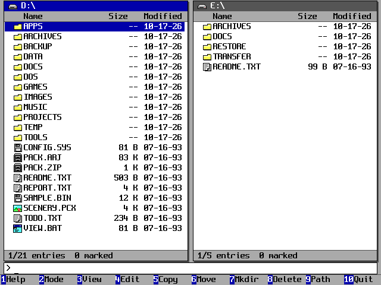

*Two folders stay visible while you browse. The blue heading shows which pane
is active; press Tab to switch sides.*

## Contents

- [Download and install](#download-and-install)
- [Your first few minutes](#your-first-few-minutes)
- [Features in pictures](#features-in-pictures)
- [More everyday tools](#more-everyday-tools)
- [Keyboard shortcuts](#keyboard-shortcuts)
- [Choose a display mode](#choose-a-display-mode)
- [What you need](#what-you-need)
- [Browser version](#browser-version)
- [Help and further reading](#help-and-further-reading)
- [For developers](#for-developers)
- [License and credits](#license-and-credits)

## Download and install

### 1. Get the DOS package

Open the [latest release](https://github.com/ifilot/nightwatch/releases/latest).
Under **Assets**, download **`NIGHTWATCH-DOS.zip`**. This contains the ready-to-run
program; you do not need to compile anything. The **Source code** downloads are
for building Nightwatch yourself.

This guide describes **v1.4.0**. If the latest published release is older, check
its release notes: ARJ extraction, archive browsing and the new VGA icons require
v1.3.0 or newer; the F9 drive picker requires v1.4.0.
[All releases are listed here.](https://github.com/ifilot/nightwatch/releases)

### 2. Extract the files

Unzip the package into its own folder. For example, on Windows you could use
`C:\DOS\NW`. Keep all the included license files with `NW.EXE`.

`NW.EXE` is a DOS program. Run it inside DOSBox or on a DOS PC.

### 3. Start Nightwatch

**In DOSBox:** start DOSBox and enter these commands at its DOS prompt:

```dos
mount c "C:\DOS"
c:
cd \NW
NW /vga
```

Replace `C:\DOS` with the folder on your computer that contains the extracted
`NW` folder. DOSBox sees that mounted folder as drive C:. Mount other folders or
drives in DOSBox if you want to use them too.

**On a DOS PC:** copy the extracted folder to your DOS disk, change into that
folder and run:

```dos
NW
```

This starts in text mode. If you have a VGA card, use `NW /vga` for the colour
interface shown above. Press **F10** to quit.

The optional `NIGHT.ICC` file is a launcher icon for Quick Menu. Import it there
if you use Quick Menu; Nightwatch itself does not need it.

## Your first few minutes

1. **Choose a folder.** Use the arrow keys to select a folder and press
   **Enter** to open it. **Backspace** goes up one folder when the command line
   is empty. **F9** opens the drive picker: use the arrows or a drive letter,
   then **Enter** to open its root. Choose **Enter a path...**, or press **.**
   inside the picker, to jump directly to a folder.
2. **Open your destination.** Press **Tab** to switch to the other pane, then
   navigate to the folder where you want to put files. Press Tab to return.
3. **Look inside a file.** Select it and press **F3**. Use **PgUp/PgDn** to read
   more, then **Esc** to return to the file list.
4. **Copy a file.** Select it, press **F5**, check the destination and press
   **Enter**. The other pane's folder is the suggested destination.
5. **Work with several files.** Press **Insert** to mark each one, then **F5**
   to copy the marked selection. You can mark folders too.

To start with two particular folders already open, give their paths after the
program name. For example, if both folders exist:

```dos
NW /vga C:\WORK C:\BACKUP
```

## Features in pictures

### Choose a drive with F9

Press **F9** to see the configured drives. Use the arrow keys or a drive letter
to select one, then press **Enter** to open it in the active pane. Recognised
floppy, fixed-disk and Slot-otter SD drives have their own VGA icons in the
picker and pane headers; other drives
use a generic icon. Choose **Enter a path...**, or press **.**, to type a folder path.

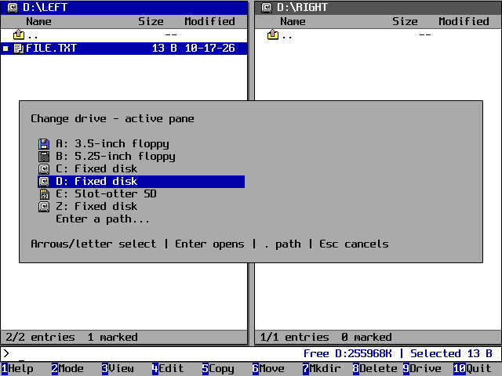

### Copy files with a clear view of progress

Nightwatch shows progress for the current file and the whole selection, along
with transfer speed and an estimate of the time left for the current file.
Press **Esc** to cancel a transfer. If a destination file already exists, you
can choose whether to overwrite it or skip it.

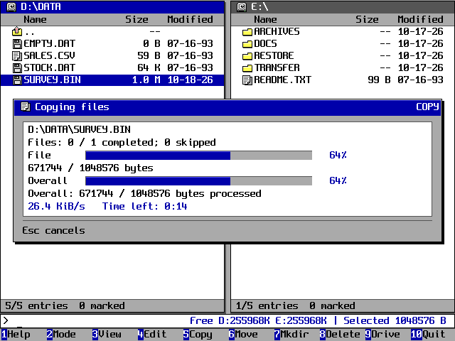

*Here, a 1 MB file is being copied from the left pane's DATA folder to drive E:.*

### Read text and inspect other files

Press **F3** to read a file without changing it. The text viewer shows the
current line and total line count. **Shift-F3** opens a hex view, which shows
individual bytes and their text equivalents. Inside either viewer, **F4**
switches between text and hex, **F7** searches and **F8** finds the next match.

| Read text | Inspect bytes |
| --- | --- |
| 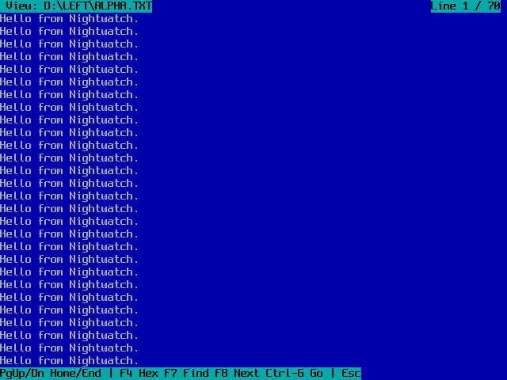 | 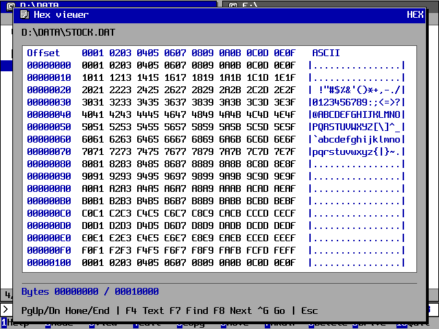 |

### Open ZIP and ARJ files like folders

Select a `.ZIP` or `.ARJ` file and press **Enter**. Browse its folders, view a
file with **F3**, or select files and press **F5** to extract them into the other
pane. At the archive's top level, **Backspace** returns to the containing folder.

To unpack a whole archive directly from the normal file list, select it and
press **Ctrl-U**.

| Browse an archive | Extract its files |
| --- | --- |
| 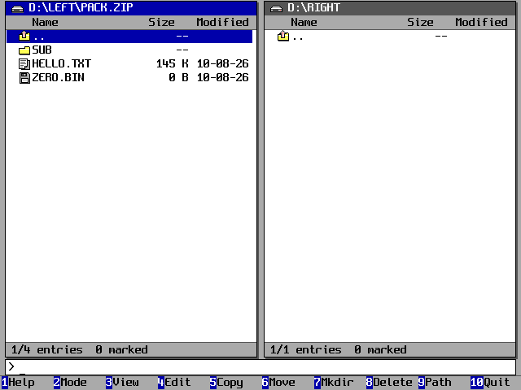 | 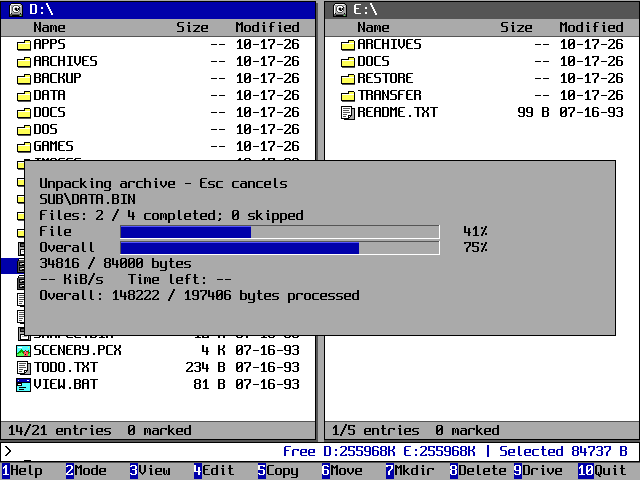 |

*Archive contents are read-only. Extract files before editing them, and extract
an archive stored inside another archive before opening it.*

### Find, mark and sort your files

Use **Ctrl-F** to find a filename. **Ctrl-P** marks files matching a pattern,
such as `*.TXT`; **Ctrl-N** clears marks matching a pattern. Press **Ctrl-S**
to sort by name, size, date or extension, or to reverse the order.

| Mark files by name | Sort the file list |
| --- | --- |
| 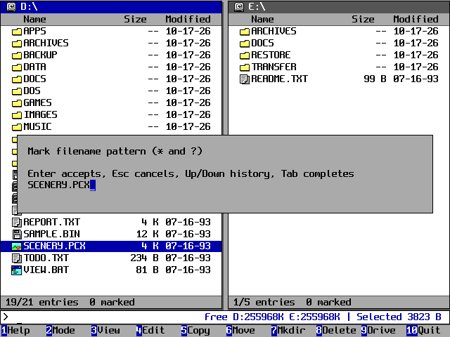 | 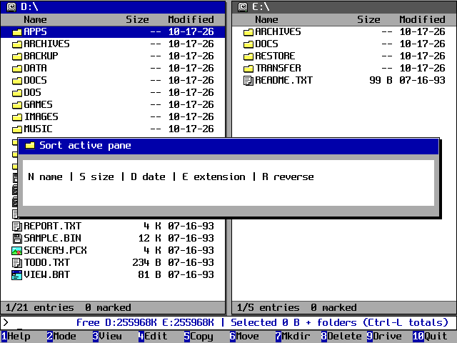 |

There is also a built-in storage test for checking a writable DOS drive with
sample files. Press **Ctrl-T** to open it. See the [storage test guide](docs/storage-test.md)
for how to run a test, verify its results and remove its test files.

[Explore the complete VGA screenshot gallery →](screenshots/README.md)

## More everyday tools

- **Run a program:** select an `.EXE`, `.COM` or `.BAT` and press Enter.
  It runs in the active folder. Press a key when it finishes to return.
- **Check capacity:** the idle status line shows free space on both pane drives (K means KiB)
  and bytes in the selected files. **Ctrl-L** calculates a total including
  selected folders; Escape cancels a long calculation.
- **Handle many conflicts:** copy prompts show both files' sizes and dates.
  Choose **O** to overwrite once, **A** to overwrite all conflicts in this
  operation, **S** to skip once or **K** to skip all. After a transfer error,
  **R** retries the failed file, **S** skips it and **Esc** cancels the remaining
  work. Completed files stay in place.
- **Browse large folders:** **Ctrl-PgDn** opens the next directory page and
  **Ctrl-PgUp** returns to the previous one. Each page holds up to 512 entries.
  `[MORE]` means there are more entries. Sorting and marks apply to the current
  page; changing pages clears its marks after confirmation.
- **Find a file anywhere below a folder:** press **Alt-F7**, choose the starting
  folder or drive root and enter a pattern such as `*.TXT`. **N** finds the next
  match, **Enter** opens its location and **Esc** stops the search.
- **Inspect and change attributes:** **Ctrl-A** opens properties. **R**, **H**,
  **S** and **A** toggle Read-only, Hidden, System and Archive. **Enter** saves;
  **Esc** leaves the attributes unchanged.

| Resolve copy conflicts | Inspect file attributes |
| --- | --- |
| 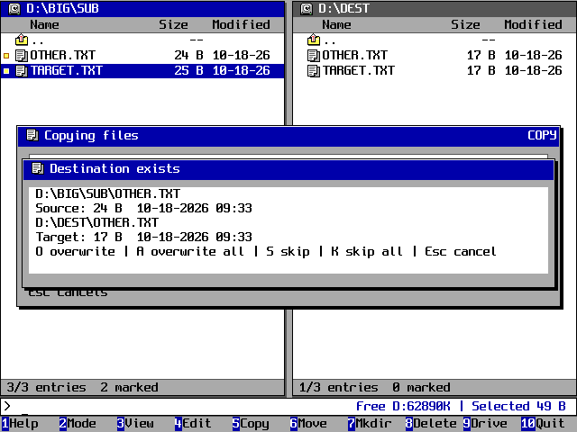 | 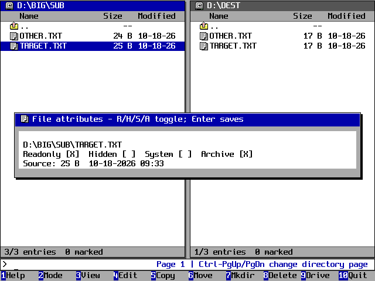 |

Path and command fields support **Left/Right**, **Home/End**, **Delete** and
**Backspace**. **Tab** completes a filename or folder from the active directory;
ambiguous names complete only their shared prefix. **Up/Down** recall recent
input in dialogs. Use **Ctrl-E/Ctrl-X** for command history, including when the
command line is empty. Histories last for the current session.

## Keyboard shortcuts

The function-key labels at the bottom of the screen are always there as a
reminder. Press **F1** for help inside Nightwatch.

| Key | What it does |
| --- | --- |
| **↑ / ↓**, **PgUp / PgDn** | Move through the file list |
| **Tab** | Switch between the two panes |
| **Enter / Backspace** | Open a folder or archive, run a DOS program / go up a folder |
| **Insert / Space** | Mark or unmark the selected entry |
| **+ / -** | Mark all entries / clear all marks, with an empty command line |
| **F1 / F2** | Open help / choose a display mode |
| **F3 / Shift-F3** | View a file as text / hex |
| **F4** | Open the file in an external editor, such as DOS EDIT |
| **F5 / F6** | Copy / move or rename the selection |
| **F7 / F8** | Create a folder / delete the selection after confirmation |
| **F9 / F10** | Pick a drive (or enter a path) / quit Nightwatch |
| **Ctrl-U** | Unpack an archive, or extract selected entries while browsing one |
| **Ctrl-F / Ctrl-S** | Find a filename / sort the file list |
| **Ctrl-P / Ctrl-N** | Mark / unmark files using a filename pattern |
| **Alt-F7** | Search filenames beneath a folder or drive root |
| **Ctrl-A / Ctrl-L** | File attributes / calculate selection size including folders |
| **Ctrl-PgUp / Ctrl-PgDn** | Previous / next directory page |
| **Ctrl-E / Ctrl-X** | Previous / next command from session history |
| **Ctrl-R** | Refresh the file lists |
| **Ctrl-W** | Save the current display mode, folder paths and sorting |
| **Ctrl-O** | Open a DOS shell; type `EXIT` to return |
| **Esc** | Cancel a dialog or clear the command line |

**F4** needs a separate editor installed. Nightwatch uses the `EDITOR`
environment variable, or tries `EDIT` if it is unset.

## Choose a display mode

Use the mode that suits your computer. You can choose it when starting
Nightwatch, or press **F2** during use and then **T**, **C**, **E** or **V**.

| Text · `NW /text` | CGA · `NW /cga` |
| --- | --- |
| 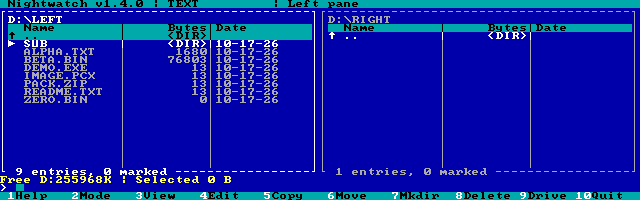 | 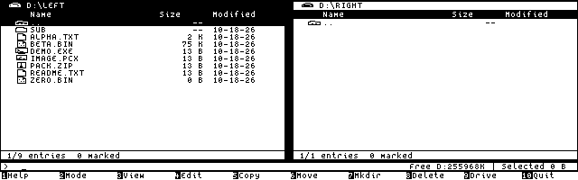 |
| **EGA · `NW /ega`** | **VGA · `NW /vga`** |
| 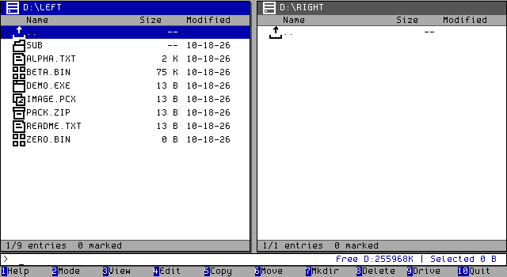 |  |

Press **Ctrl-W** to save your display choice, open folders and sorting in
`NIGHT.CFG`. To remember later display changes automatically, press **F2**,
then **R** to turn that option on.

## What you need

- **MS-DOS 3.0 or later**, or DOSBox/DOSBox-X on a modern computer.
- An **8088/8086 or newer** processor and about **256 KB of free conventional memory**.
- A compatible text, CGA, EGA or VGA display. EGA mode needs at least 128 KB of
  video memory.
- A keyboard. The DOS application does not use a mouse.

Files and folders must use **DOS 8.3 names**: up to eight characters before the
extension and three after it, such as `REPORT.TXT`. Directory listings use pages of up to 512 entries; Ctrl-PgDn/PgUp reach further
entries. Sorting and marks are local to a page. Archive listings retain a
512-entry limit. Recursive file operations and filename search process entries
beyond the visible page.

ZIP extraction supports stored and DEFLATE-compressed files. ARJ extraction
supports stored files and methods 1–4. Encrypted or split archives are not
supported. See the [ZIP](docs/zip-support.md) and [ARJ](docs/arj-support.md)
guides for the full format limits.

## Browser version

The project also includes a web version that runs the real DOS program in
DOSBox inside your browser. It comes with fictional D: work and E: backup drives,
so you can try browsing, copying and unpacking sample files. Changes are cleared
when you reset or reload the page; your computer's files are not mounted.

The web interface includes on-screen keys, pause, fullscreen, reset and a
filterable screenshot gallery. Its Find, Attributes and Size buttons send the
new shortcuts directly; Size avoids the browser-reserved Ctrl-L shortcut.
See [For developers](#for-developers) below to
build and serve it locally. [Website deployment instructions](docs/ci.md)
explain how to publish it with GitHub Pages.

## Help and further reading

- **[Full manual](docs/manual.md):** controls, settings and detailed behaviour.
- **[Screenshot gallery](screenshots/README.md):** 61 VGA captures showing the interface in use.
- **[Storage test guide](docs/storage-test.md):** testing drives and checking results.
- **[Changelog](CHANGELOG.md):** what changed in each version.
- **[Report a problem](https://github.com/ifilot/nightwatch/issues):** include your
  Nightwatch version, DOS or emulator version, display mode, and what happened.

## For developers

You only need the download above to use Nightwatch. If you want to build it
or explore the code, start with the [build environment guide](buildenv/README.md).
The repository includes the DOS compiler environment and a Docker build recipe.

With the [native build requirements](buildenv/README.md) installed:

```sh
make build          # Build build/NW.EXE
make run            # Run VGA with sample hard disks, floppies and an SD card
make test           # Run host tests
make package        # Create the downloadable DOS package
make site           # Build the self-contained browser version
make serve-site     # Serve it at http://localhost:8000
```

`make run` includes A: (3.5-inch, 1.44 MB), B: (5.25-inch, 360 KB), D: (work),
E: (backup) and S: (simulated SD card). Press F9 to explore them. It preserves
changes between launches: floppy files live in `build/demo/A.IMG` and `B.IMG`;
D:, E: and S: use their matching folders under `build/demo/`. The SD identity is
simulated for the demo; no Slot-otter hardware is needed. The browser demo
resets its D: and E: drives on reload. Building the website downloads
checksum-verified emulator files on the first run and caches them for later builds.

See [CI and deployment](docs/ci.md), [rendering notes](docs/rendering.md),
[asset credits](assets/README.md) and [source comment style](docs/commenting.md)
for more technical detail.

## License and credits

Nightwatch is free software under the [GNU GPLv3](LICENSE). Spleen fonts use a
BSD license. The VGA icons are original Quick Menu inspired artwork; EGA icons
are adapted from Paul Mackenzie's [16pxls](https://16pxls.com/) under CC-BY-SA-4.0.
See the [font license](assets/FONT-LICENSE.txt), [icon credits](assets/ICON-LICENSE.txt)
and [zlib license](vendor/zlib/LICENSE). The included Borland development tools
have their own [proprietary notices](buildenv/BORLAND-NOTICE.md).
