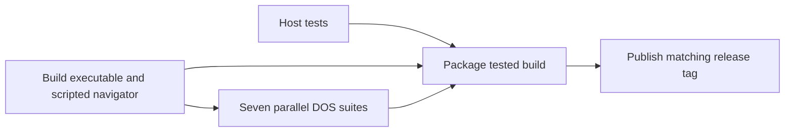

# CI and releases

[build.yml](../.github/workflows/build.yml) runs on every branch/tag push and can
be started manually. All jobs use GitHub-hosted Ubuntu 24.04 machines.
Pull requests run host regression tests. Pushes and manual runs also compile and
test DOS in the standalone [build environment](../buildenv/README.md).

## Build environment

`buildenv/TC/` and `buildenv/TASM/` contain the supplied Turbo C 2.0 and Turbo
Assembler 2.0.1 tools, headers and libraries. The Docker image uses Debian
Trixie and installs DOSBox and DOSBox-X as binary packages from Debian, alongside
the host build and test tools. The GitHub-hosted runner remains Ubuntu 24.04.
Compiler inputs come from this checkout; no emulator is compiled during image
creation. The Docker image is saved in the Actions cache, keyed by runner
OS/architecture and every file in `buildenv/`. A cache miss rebuilds it normally.
Changing those files invalidates the cache; deleting the Actions cache or bumping
`dosenv-v1` in the environment action forces a package/base-image refresh. Git generates the build commit in `src/BUILD.H`, which is refreshed at
build time and excluded from version control.
No self-hosted runner, compiler secret or Actions variable is required.

To reproduce the CI environment locally:

```sh
docker build -t nightwatch-build buildenv
docker run --rm --user "$(id -u):$(id -g)" \
  --volume "$PWD:/workspace" nightwatch-build \
  bash -c 'make clean && make build && make test-dos && make test-zip-dos && make test-video && make benchmark && make package'
```

The image build needs Debian's base image and package mirrors. Original Borland
notices remain in `buildenv/`; Debian's DOSBox-X license notices are installed
under `/usr/share/doc/dosbox-x/` in the image. The old vendored DOSBox-X sources
remain available for manual source builds and earlier benchmark reproduction.

The workflow removes old output, compiles `NW.EXE`, checks the 64 KB near-data/stack
budget, and prepares one scripted navigator shared by the UI suites. It then
runs independent DOS/FAT12, ZIP, progress, display/keyboard, feature/settings,
storage and rendering-benchmark jobs in parallel. Host tests enforce C89 warnings and address/undefined sanitizers.
Every test script has a named, timed Actions step. All matrix jobs finish even
if one fails, and any failure blocks packaging and publishing. Diagnostic logs,
linker maps and screen-state records are retained per suite.

## Shared build and parallel tests



The build job uploads its compiled inputs once, including `NW.EXE`, the scripted
navigator, and checked ZIP/storage objects. Each test job restores its own copy;
no test suites share a mutable DOS directory. Source/toolchain fingerprints and
executable hashes reject stale or damaged navigator artifacts. Object reuse
requires matching source/header bytes, compiler/assembler/library inputs,
compiler flags, and object checksums. Fresh test executables are still linked
and checked by the DOS compiler gate.

Packaging uses the original tested executable from that same workflow's build
artifact. It runs only after the host checks and every DOS suite pass. It does
not rebuild the executable after testing. Runtime artifacts contain neither the
compiler nor diagnostic test programs.

New commits cancel older runs for the same branch/event or pull request. Tag
runs are never automatically cancelled. Host checks remain quick on pull
requests; branch/tag pushes and manual runs exercise the full DOS matrix.

For local sequential runs, `make test-video` still builds the scripted navigator
and runs all UI/storage checks. To prepare it separately, use
`python3 tests/ui_build.py`; `NW_UI_PREBUILT=1 python3 tests/video.py` verifies and
uses that prepared executable. `python3 tests/ui_build.py --verify` checks the
shared inputs without starting DOSBox.
`make benchmark-speed` needs a local before-source snapshot and is not a CI check.

## Tag releases

The project version lives in `VERSION`. Run `python3 tools/version.py --set v1.0.1`
to update it, the committed DOS header and README badge together. Commit those
changes, then push the matching tag. A tag must match the packaged version;
otherwise publishing fails before a release is created.

```sh
git tag v1.0.0
git push origin v1.0.0
```

The release waits for the fully gated package job and downloads that run's DOS artifact.
It verifies SHA-256 hashes before publishing:

- `NW.EXE`: one 8088 executable containing every display mode.
- `NIGHT.ICC`: the transparent 32x32 EGA Quick Menu launcher icon.
- `LICENSE.TXT`: GNU GPL version 3 for Nightwatch.
- `VERSION.TXT`: the built version, such as `v1.0.0`.
- `FONTLIC.TXT`: the embedded font license.
- `ICONLIC.TXT`: 16pxls icon attribution and CC-BY-SA-4.0 license.
- `NIGHTWATCH-DOS.zip`: executable, all licenses, version and a DOS README.
- `SHA256SUMS.txt`: hashes for the executable, Quick Menu icon, licenses, version and ZIP.

Only release publishing receives `contents: write`; build jobs receive read
access. Rerunning a successful tag workflow replaces its release assets.
Branch builds expose the same package through workflow artifacts. Compiler files
and the build environment are not included in the downloadable DOS package.
