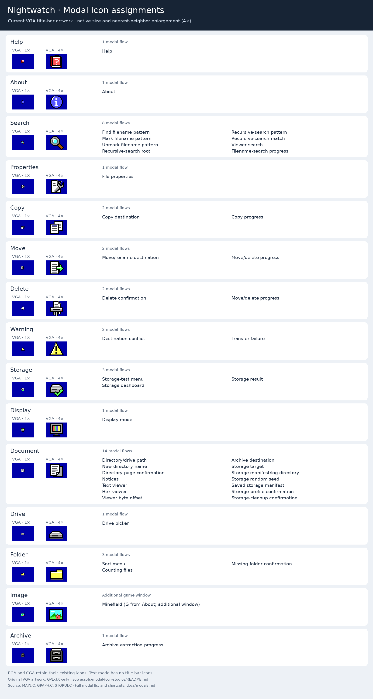

# Modal inventory

This lists the public file-manager and storage modal flows. Several flows share
one implementation: for example, filename patterns and directory paths use the
same input dialog, while errors and informational messages use one notice dialog.
External editors, launched programs and the DOS shell are separate processes.

| Modal | Entry point / purpose | VGA icon |
| --- | --- | --- |
| Help | F1; scrollable embedded reference | Help |
| About | Alt-F1, or A in Help; version and credits | About |
| Display mode | F2; display selection and remember-mode setting | Display |
| Sort menu | Ctrl-S; name, size, date, extension and reversal | Folder |
| Drive picker | F9; configured drives and direct-path option | Drive |
| Directory/drive path | `.` or the path option inside F9 | Document |
| Find filename pattern | Ctrl-F | Search |
| Mark filename pattern | Ctrl-P | Search |
| Unmark filename pattern | Ctrl-N | Search |
| Copy destination | F5; absolute destination path | Copy |
| Move/rename destination | F6; absolute destination path | Move |
| New directory name | F7 | Document |
| Delete confirmation | F8; confirm file or recursive directory deletion | Delete |
| Directory-page confirmation | Ctrl-PgUp/PgDn when marks would be cleared | Document |
| Destination conflict | Existing output; source/target metadata and overwrite/skip choices | Warning |
| Transfer failure | Retry, skip or cancel after a copy/move/extraction error | Warning |
| Notices | Errors, invalid input, missing matches and settings failures | Document |
| File properties | Ctrl-A or supported Alt-Enter; DOS attributes and metadata | Properties |
| Recursive-search root | Alt-F7; starting directory | Search |
| Recursive-search pattern | Alt-F7; filename pattern beneath that root | Search |
| Recursive-search match | Enter opens the location, N continues, Esc stops | Search |
| Text viewer | F3; also used for checked archive members | Document |
| Hex viewer | Shift-F3, or F4 inside the text viewer | Document |
| Viewer search | F7; text or hexadecimal pattern | Search |
| Viewer byte offset | Ctrl-G; decimal or hexadecimal position | Document |
| Counting files | Before copying or while calculating recursive selected-byte totals | Folder |
| Filename-search progress | Recursive enumeration; Escape cancels | Search |
| Copy progress | Current-file and overall progress, transfer rate and ETA | Copy |
| Move/delete progress | Bytes, completed/skipped counts and cancellation | Move / Delete |
| Archive destination | Ctrl-U on ZIP/ARJ; existing output directory | Document |
| Archive extraction progress | Ctrl-U, or F5/Ctrl-U on archive members | Archive |
| Storage-test menu | Ctrl-T; quick, long, saved verification or cleanup | Storage |
| Storage target | Quick/long test; directory on the device being tested | Document |
| Storage manifest/log directory | Quick/long test; evidence on another drive | Document |
| Storage random seed | Quick/long test; reproducible 32-bit seed | Document |
| Saved storage manifest | Verify/cleanup; path to a recorded plan | Document |
| Storage-profile confirmation | Approve quick/long workload before creating test files | Document |
| Missing-folder confirmation | Approve creation of a storage target or local evidence folder | Folder |
| Storage-cleanup confirmation | Approve removal of recorded test data | Document |
| Storage dashboard | Running quick/long test, saved verification or cleanup | Storage |
| Storage result | Passed, failed or cancelled report; retained evidence and next steps | Storage |

## Modal icons

The [approved VGA designs](modal-icon-proposals.png) are now embedded in
Nightwatch. Properties uses the document and wrench; Display uses the color-bar
monitor; Delete uses the paper shredder. The [comparison sheet](modal-icon-alternatives.png)
retains the other Properties and Display studies.

The table records VGA title-bar assignments. EGA and CGA keep their existing
icons; text mode has no title-bar icons. Plain prompts and notices use Document.
Minefield (G from About) uses Image. Regenerate the overview with
`python3 tools/modal_icons.py` after changing the table or running `make assets`.
Assignments come from `MAIN.C`, `GRAPH.C`, and `STORUI.C`.

VGA artwork is GPL-3.0-only; EGA artwork is adapted from 16pxls by Paul Mackenzie
(CC-BY-SA-4.0); CGA artwork is GPL-3.0-only. The VGA modal sprites are stored
outside the near heap in FONTDATA alongside the fonts and drive sprites.

## Shared graphics style

CGA, EGA and VGA use the same native frame function,
`graph_window_frame()` in [GRAPH.C](../src/GRAPH.C): black outline, light edge,
shadow, title strip, white title text and an icon. EGA/VGA use the blue title
strip; CGA uses its monochrome equivalent. VGA icons identify each operation; EGA/CGA use
the existing document, folder, drive, image and archive symbols.

Help, About, viewers and copy/unpack progress paint native document bodies.
The smaller menus and prompts keep their established cell-based keyboard layout,
with native chrome painted after the body flush so cells cannot overwrite it.
The storage dashboard shares the frame while retaining its checklist, status
badges and incremental progress updates. Text mode keeps its character-based
presentation and controls.

`tests/modals.py` checks title strips, icons, repeated entry and restoration in
all display modes. Viewer, transfer and storage tests cover the other native
windows and nested prompts. Run `make test-video` for the complete UI checks.
