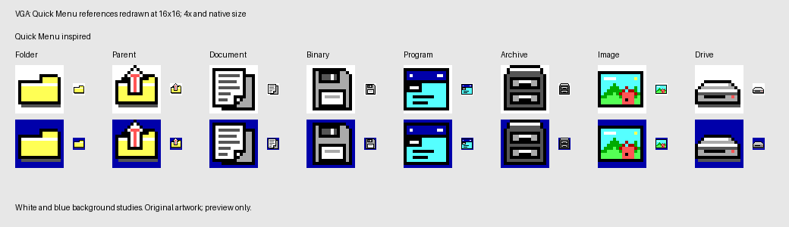

# Nightwatch 1.3.0 design history

These are historical planning and integration notes, retained for provenance.
The proposals below have since been implemented; they are not a pending-work
list or the current release specification. Use [the manual](manual.md),
[ARJ support](arj-support.md) and [the asset notes](../assets/README.md) for
current behavior, limits and artwork. This filename is retained for existing links.

The confirmed release scope has two tracks: built-in ARJ unpacking and a new
set of icons inside Nightwatch inspired by Quick Menu and Windows 3.x. The
existing Quick Menu launcher icon is outside this redesign. ARJ extraction is
now embedded in NW.EXE, along with the original Quick Menu inspired VGA icons. See [ARJ support](arj-support.md) for the implemented subset.

## ARJ extraction

ARJ extraction must be built in, like ZIP, with no external ARJ.EXE dependency.
Use Ctrl-U to extract into the inactive pane, retaining ZIP support and the
standalone executable. The decoder probe must establish a feasible memory
budget for the supported machines.

ARJ needs a new codec: zlib's DEFLATE decoder cannot decode its compressed
methods. The [ARJ technical notes](https://raw.githubusercontent.com/tripsin/unarj/master/TECHNOTE.TXT)
describe stored method 0, a shared LZ77/Huffman decoder for methods 1–3, and a
separate LZ77 decoder for method 4. Headers and file data carry CRCs. Sequential
local headers allow a bounded scan followed by an extraction pass.

Proposed initial scope: single-volume archives, methods 0–4, DOS 8.3 paths,
directories and binary files. Reject encryption, split volumes, chapters,
unsupported file types and methods, and executable self-extractors. Decide
text-mode conversion explicitly before accepting text entries.

Implementation milestones (the native implementation and automated checks now
cover the sequence below):

1. Build an isolated Turbo C 2.0 / 8086 decoder probe. Establish decoder source
   licensing and provenance before importing code; source availability alone
   is insufficient. Measure code size, near data, far heap and execution time.
2. Add bounded header parsing and CRC validation, a complete preflight scan,
   DOS name/path collision checks, and declared input/output limits.
3. Reuse the operation callbacks and staged file replacement used by ZIP:
   overwrite/skip, Escape cancellation, progress, timestamps and cleanup.
   Extract shared helpers only where both formats need identical behavior.
4. Dispatch Ctrl-U by validated archive format; preserve `/unzip` and consider
   `/unarj` for unattended extraction with the same no-overwrite policy.
5. Retain independently generated archives for every supported method, with
   original-file hashes and producer versions. Cover corrupt headers/data,
   truncation, unsafe paths, duplicates, unsupported features, filesystem
   faults and cancellation. Verify >64 KiB outputs on 8086 and real FAT12.

The existing build requires at least 2 KiB near heap after its 8 KiB stack;
the probe must retain that margin and evaluate the 256 KiB free-RAM target.
The production build enforces the near-heap margin; the retained DOS tests
exercise the decoder on the actual Turbo C / 8086 ABI.

## Browsing archives as folders

Enter now opens ZIP/ARJ contents as a read-only pane without unpacking the
archive. Subfolders, parent navigation, sorting, marking and refresh work with
the existing pane controls. F3/Shift-F3 views a single checked member through
an owned temporary file; F5 extracts selected files or whole folder subtrees.
Archive writing and nested archive browsing remain unsupported. The browser's
cache and navigation state use far allocations to retain the near-heap budget.
See [the manual](manual.md#browsing-zip-and-arj-archives) for controls and limits.

## File-browser icons

VGA is the primary target for the redesign. Judge the artwork at native size
in the 640×480 VGA interface, including selected and marked file rows. EGA
and CGA adaptations are secondary and should follow the VGA design.

The original study used a local Quick Menu icon collection for visual
references; that sibling directory is not a build dependency. See
[the reference mapping](../assets/icons-v130/README.md#quick-menu-source-references)
for the selected examples. The confirmed size is **16×16**, redrawn directly
on that grid to retain the current number of visible files.

VGA now uses 16×16 sprites with one opacity mask and four color planes
(160 bytes per icon). The renderer preserves the row background under transparent
pixels and keeps the artwork colors on selected rows. EGA retains its monochrome
16×16 masks and CGA its existing 16×8 artwork.

Two original studies cover folder, parent directory, document, binary,
program, archive, image and drive. The Windows-inspired direction uses paper,
yellow folders, gray hardware and dark blue details. The Quick Menu-inspired
direction now follows the reviewed references: yellow folders, gray paper
details, disk media, a cyan application window, a filing cabinet, a landscape
and shaded drive hardware. These are visual studies rather than reproductions
of historical icons.

Regenerate with `python3 tools/icons_v130.py`. Each PNG is a transparent 16×16
asset using only standard EGA colors and binary alpha. Preview tiles show
white and blue backgrounds at native size and nearest-neighbor 4× scale;
they are host previews, not emulator captures or a final selection treatment.
The artwork and generator are original GPL-3.0-only assets.

VGA is integrated with the existing selection, marking and scrolling paths.
Pixel checks compare actual emulator VRAM with the authored artwork, including
transparency on selected rows. The renderer benchmark checks idle writes and
selection redraws. Text mode retains its character-based presentation.
